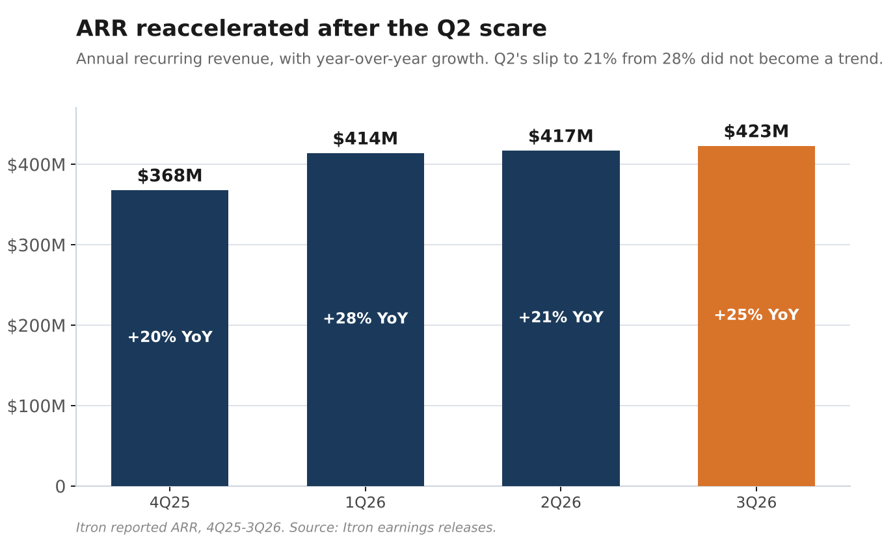
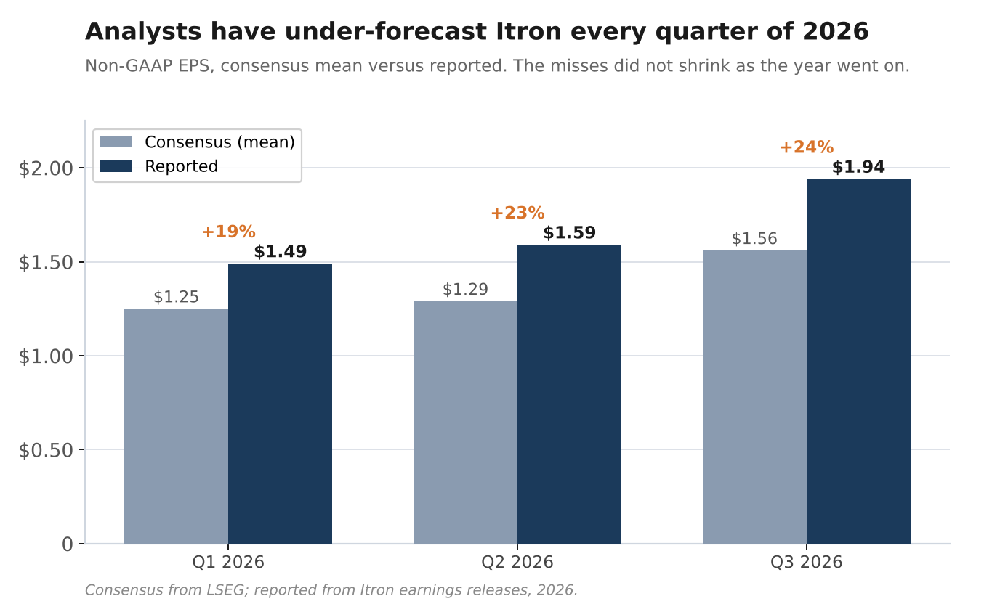
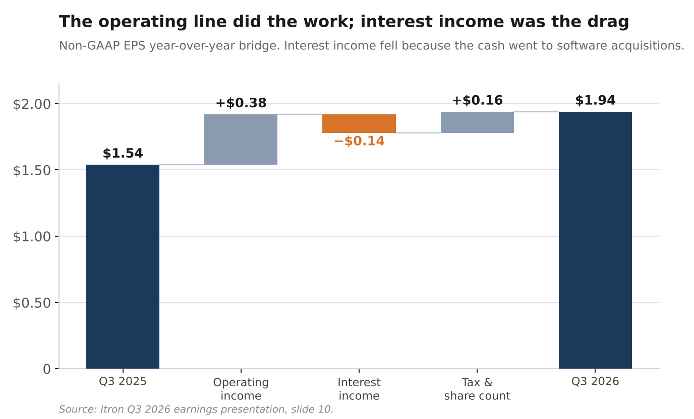
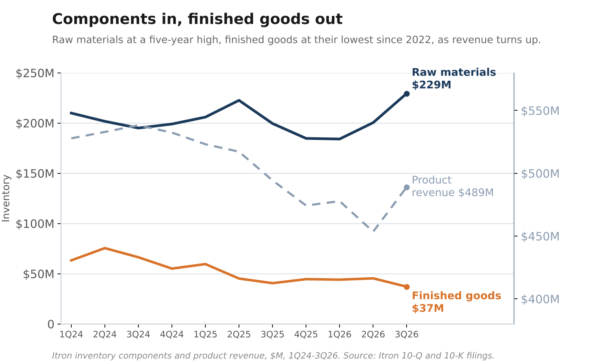

# Itron Raised Guidance. The Screen Still Reads a Decline.

*They raised the guide. The same number still screens as a 5% earnings drop. Normalized for tax and interest income, it is up 14%, on the company's own math.*

PRIMARY SOURCE ARBITRAGE · October 27, 2026

---

For readers new to the series, the case in one paragraph. Itron makes the meters and network equipment utilities run their grids on, and it is turning that installed base into recurring software, analytics and services revenue. It began reporting that as annual recurring revenue, ARR, only four quarters ago. The market still prices Itron as a hardware company, near 14 times this year's earnings, while the recurring line grows in the low twenties and carries much higher margins than the hardware. The re-rating I am waiting for comes when management gives analysts the segment-level targets needed to value the software on its own, which I expect at an investor day in early 2027. This post is what the third quarter did to that case.

## The short version

- **What happened.** Itron reported Q3 on October 27. Revenue of $599 million grew 3%, its first year-over-year increase since the first quarter of 2025. Annual recurring revenue, the software line, reached $423 million, up 25% and reaccelerating from 21% last quarter. Non-GAAP EPS was $1.94 against a $1.56 consensus. Management raised the full-year EPS outlook for the second straight quarter, to $6.72-$6.82.
- **Why it looks like a decline anyway.** That full-year midpoint, $6.77, is 5% below 2025's $7.13. Normalized for a 2025 tax benefit and falling interest income, it is 14% higher. Interest income fell because the cash that earned it went to two software acquisitions, Urbint and Locusview, which added the recurring revenue.
- **What happens next.** Q4 is guided to $1.70-$1.80 on revenue up 10%. After the usual Q4 cost step-up, the guide still implies gross margin falls from Q3, which has not happened in a Q4 since 2021. 2027 guidance comes in February. The segment target framework that lets analysts value the software, what I have been calling the forcing function, comes after the Resiliency integration finishes in early January, which on the 2024 precedent points to roughly March.
- **What I hold.** Itron. I added this morning.
- **What would prove me wrong.** ARR growth below 15% for two consecutive quarters. Reported is 25%, but acquisitions flatter it and the rate laps below 15% in 2027 on the comparison alone. I re-base the rule on management's forward ARR targets once the Investor Day gives them.

---

## The reported quarter

Revenue was $599 million, up 3%. ARR was $423 million, up 25%. The quarter that mattered for the thesis was the one before this one: in Q2, ARR growth fell to 21% from 28% in Q1, and the question was whether that was a single soft print or the start of a trend. The build since management began disclosing the metric: $368 million at the end of 2025, $414 million in Q1, $417 million in Q2, $423 million now. Q3 answered the question in the direction I needed, and the rate went up.

*Itron's annual recurring revenue by quarter, with year-over-year growth. The Q2 slip to 21% from 28% did not become a trend. Source: Itron earnings releases, 4Q25 to 3Q26.*

One honesty check on that 25%. The sequential adds have been small, $3 million in Q2 and $6 million in Q3; the big step was earlier, from $368 million at the end of 2025 to $414 million in Q1, which is largely the acquired recurring revenue of the Resiliency segment entering the base. That matters for what comes next. At $6 million of adds a quarter, reported growth is about 17% in Q4, then roughly 5 to 6% through 2027, because by the first quarter the acquisitions sit in both periods and only organic growth shows. On the reported number, that puts ARR below 15% for two straight quarters by the Q2 2027 print, and my first break condition, set in August, trips.

But it trips on the lap, not a slowdown, and stripping the acquisitions back out does not rescue it, because by 2027 Resiliency is part of the organic base too. The question the rule is meant to answer, whether the recurring engine is actually decelerating, cannot be read off a comparison this distorted. So I am saying now, before it trips rather than after, how I re-base it: once the Investor Day gives a segment-level ARR run-rate and a forward target, rule 1 grades on whether ARR is tracking to that target. Until those targets exist, I watch the sequential dollar adds and whether the Resiliency cross-sell has started to show. That is the clearest reason the Investor Day matters. Without the framework, the one ARR number I have is about to stop meaning anything.

Adjusted EBITDA was $115 million, a 19.1% margin, a quarterly record. Non-GAAP earnings were $1.94 per share against $1.54 a year ago. The number to hold onto is not the year-over-year figure but the one against expectations: the consensus was $1.56, the mean of eight estimates on LSEG. That is a 24% beat. It is also the third of its size this year. Q1 was $1.49 against $1.25. Q2 was $1.59 against $1.29. Q3 was $1.94 against $1.56. The analysts covering this company have under-forecast it every quarter of 2026, and the misses have not gotten smaller as the year went on.

*Non-GAAP EPS, consensus mean versus reported, for each quarter of 2026. Source: consensus from LSEG; reported from Itron earnings releases.*

That record is worth more to the thesis than any single multiple, because it is the gap I write about caught in the act. The people whose models set the price keep building the hardware company and keep getting surprised by the earnings.

## The headline says earnings fell

Here is the number I went to the slides for. On its full-year outlook, Itron guided non-GAAP EPS to $6.72-$6.82. The company's own slide 17 describes the midpoint as "down $0.36 or 5% vs 2025," and then, on the next line, "Normalized for tax rate and interest income, up $0.81 or 14% at the midpoint." The fourth-quarter slide says the same thing louder: $1.70-$1.80 is "down $0.71 or 29% vs Q4 2025," and normalized, "up $0.14 or 9%."

Two things sit between the headline and the operating business. The first is tax. The 2025 base of $7.13 carried a fourth-quarter tax benefit; 2025's fourth-quarter non-GAAP earnings were $2.46 a share, a 19.8% net margin, higher than any operating quarter around it. The second is interest income, and it is the more interesting of the two. It fell from $13.6 million in Q3 2025 to $7.2 million this quarter, a $6.4 million drop, because the company spent its cash balance on Urbint and Locusview. Those are the acquisitions that built the Resiliency segment, the one printing 74% gross margins. So the line depressing the reported earnings is the same decision that added the recurring revenue. That also makes management's 14% a touch generous: it adds the interest income back while keeping the earnings the cash was spent to buy. Dock it for that and the normalized number is smaller, but it is still growth, not the decline the headline shows. Hooper walked the year-over-year bridge on the call (Joan Hooper, Q3 2026 earnings call, October 27, 2026): operating income added $0.38 a share, interest income subtracted $0.14, and taxes and share count added $0.16. That bridge runs this September quarter against last, a different comparison from the full-year tax step-down above, so the tax line helps here rather than hurts. Either way the operating line did the work, against an interest-income drag the company chose.

*Itron's non-GAAP EPS year-over-year bridge: operating income added $0.38, interest income subtracted $0.14, taxes and share count added $0.16. Source: Itron Q3 2026 earnings presentation, slide 10.*

Now set it against what the Street was carrying. The consensus full-year estimate going into the print was $6.37, which is 10.7% below 2025. The sell-side was modeling a double-digit earnings decline. The guided midpoint of $6.77 is not just above that mean; it is above the prior high estimate on the sheet, $6.72. The entire guided range sits at or above where the single most bullish analyst had been. The analysts are not missing the operating story; they can read the margin and mix shift in the same statements I can. What they will not do yet is underwrite it forward, so their models stay tethered to the hardware P&L, and a guide driven by the operating line keeps clearing the top of them.

## Where the margin came from

Adjusted gross margin was 41.3%, up 350 basis points. The release credits "favorable mix and operational efficiencies." I split the move two ways to see which.

By revenue line, both halves got more profitable. Product gross margin rose from 32.6% to 38.1% over the last two years. Service gross margin, the recurring software and analytics line, rose from 43.9% to 53.2%, and from 50.9% a year ago. So the services the thesis rests on are not only growing as a share of revenue, from 12.5% to 18.4%; they earn more on each dollar than they used to. Credit only the mix, more services in the blend, and you miss that second part: the services themselves earn more per dollar than they did two years ago. Both halves improved.

By segment, the hardware did most of the lifting this quarter, because it is most of the revenue. Here is the arithmetic. Take each segment's gross-margin gain and weight it by that segment's share of revenue. Networked Solutions, about two-thirds of the company, saw gross margin rise about 2.5 points; two-thirds of 2.5 is roughly 165 basis points. Device Solutions, about a sixth of revenue, rose about 4.5 points; a sixth of 4.5 is about 80. Outcomes adds another 15 or so. Those within-segment gains sum to about 260 of the 354 basis points, and almost all of it is the two hardware segments, which are about 80% of the company between them. The remaining ~90 is mix: Resiliency, the 74% gross-margin software segment, entering the revenue base this year at under 3% weight, which pulls the blended average up on its own. So the quarter's margin story is roughly three-quarters hardware getting more profitable to build and sell, one-quarter the software mix.

The one new risk sits in that hardware half. Deitrich, same call:

> Memory and selected component costs are rising, and we have kept pace with them as third quarter gross margin demonstrates.

The memory shortage that has Micron reporting 87% gross margins is a cost on Itron's bill of materials now. Memory is a small part of what goes into a meter, and they offset it this quarter with pricing and buffering. But it is the line that can stall the hardware side of the margin, and it is the number I am waiting on in Q4, which I come to below.

## Bookings, and the quarter the guide is hiding

Bookings were $482 million, up 27% year over year. That is not a third-quarter record, the third quarters of 2024 and 2022 were higher at $487 million and $578 million, but it is a sharp rebound off last year's $380 million. Book-to-bill was 0.80, which reads soft until you remember the denominator: bookings up 27% against a revenue base that also rose. On a trailing-twelve-month basis book-to-bill is 0.97, essentially balanced. The fourth quarter is the peak quarter for orders: bookings were $1,403 million in Q4 2024 and $737 million in Q4 2025. Deitrich said October is "off to a really nice start." I would not lean on a line like that on its own; the reason to expect a strong Q4 is in that history, not the adjective.

The part of the guide worth reading closely is the margin it implies, so let me walk it, because the step people skip is why I look at operating margin rather than the headline EPS. Start with the $1.75 midpoint. At about 44.4 million diluted shares, that is roughly $78 million of non-GAAP net income. But net income sits below two lines that have nothing to do with how well Itron builds and sells meters, tax and interest, so it is the wrong altitude to read the operation. Climb back above them. Gross the $78 million up for tax at this quarter's roughly 18% non-GAAP rate and you get about $95 million of pretax income; strip out the small net interest and you are left with about $94 million of operating income. On $628 million of revenue, that is roughly a 15% operating margin, down from 17.8% this quarter. The back-out moves with the tax and interest assumptions; hold those, and the operation is what is left.

Now the question is whether that implied squeeze lands on spending or on gross margin, which is one more step. Operating income is gross profit minus operating expense. Operating expense, adjusted, steps up every fourth quarter for the customer conference and the sales compensation on the big bookings quarter, both period costs with nothing to do with the product; it rose about $12 million from Q3 to Q4 in each of the last two years, to $142 million last year off a $130 million third quarter. Apply the same $12 million step to this year's $141 million, and Q4 adjusted operating expense is about $153 million. Add that back to the $94 million of operating income and implied gross profit is about $247 million, an adjusted gross margin near 39%, down from 41.3% this quarter. That is a gross-margin decline in a quarter where gross margin has risen from Q3 to Q4 in each of the last four years, 2022 through 2025, by 60 to 280 basis points; it last fell in 2021. So the guide is not merely conservative on spending; it needs a gross-margin drop the calendar says is unlikely. Either they are sandbagging, as they did the last three quarters, the component costs are finally arriving, or a hardware-heavy shipment quarter pulls the blend down through mix.

That is the symmetry that keeps the call honest. The one way the guide is not conservative is if gross margin does fall for the first time since 2021, and the segment detail tells me which of those three it is. The Q4 gross-margin line, read with the mix, is the number I am waiting on.

## What a 14-times multiple is paying for

At about $94, on this year's guided EPS of $6.77, Itron trades about 14 times. The S&P 500 trades above 20 times earnings. Over the last decade Itron's multiple has averaged a small premium to the market; it now sits at least a third below it. Leave the software-valuation argument aside for a moment, because this part does not need it.

Deitrich, on the call, called the investment utilities have to make "in our view, inevitable," and said "intelligence is the fastest and least expensive capacity still available." By intelligence he means the grid-smart layer Itron sells, the meters, sensors and software that let a utility pull more out of the wires it already has instead of building new generation; the claim is that squeezing the existing grid is quicker and cheaper than new power plants. Take that at face value and the question writes itself: why does a company in front of a demand build it calls inevitable trade at a no-growth multiple? The honest answer is that revenue went sideways for two years while management called demand strong. It was $615 million in the third quarter of 2024 and $599 million now. The large conversions have always been described as ahead. On gas, this quarter, Deitrich:

> It has not yet shown itself in the bookings and the P&L in any significant way. That's still ahead of us.

So the market is not asleep. It has heard "inevitable" for eight quarters and is waiting to see the revenue before it pays for it. Two flat years earned that discount.

What changed this quarter is that the revenue showed up in the guide, not just the pipeline. Fourth-quarter revenue is guided up 10% year over year at the midpoint. Some of that rate is an easy comparison against last year's $572 million fourth quarter, the low of the slump. But the dollar figure is not just a recovery: at $628 million it would be the largest quarterly revenue in the five years of data I have, past the prior high of $615 million in the third quarter of 2024. The guide does not take revenue back to where it was; it takes it higher than it has ever been. The inventory backs the clean part of it. Finished goods fell to $37 million, their lowest since 2022, which is not what a company sitting on product it cannot sell looks like, and the last time they were this lean, in the third quarter of 2022, revenue then climbed for eight straight quarters. Raw materials rose 15% to $229 million, the highest in the five years of data I have, though I read some of that as buffering against the memory shortage Deitrich described rather than pure demand. Bookings rose 27%, and Deitrich named live deployments in the Caribbean, the Southeast and the Northeast behind the growth. None of that requires a software framework or an investor day. If Q4 prints up 10% and February's 2027 guide carries a growth number instead of a flat one, the premise under the 14 times, that this is an ex-growth business, breaks on the earnings alone. That is a re-rating that can come before the one I have been writing about, and on plainer evidence.

*Itron inventory components and product revenue. Raw materials at a five-year high, finished goods at their lowest since 2022, as revenue turns up. Source: Itron 10-Q and 10-K filings, 1Q24 to 3Q26.*

The software version of the case still stands. Value Itron's hardware at one times its trailing product revenue, about $1.9 billion, a cheap price for a meter maker, and the rest of the enterprise value, roughly $3.0 billion, is what the market is implicitly paying for the recurring layer: about 7 times its $423 million of ARR. A recurring-revenue line growing 25% does not trade at 7 times anywhere else; software peers trade in the teens and higher. The fuller build is in earlier posts. For a same-industry contrast, Badger Meter, a water-meter company with its own software and services layer, trades at 32 times earnings against Itron's 14. The market will pay a premium multiple for a meter company. It has just decided it needs the framework first, and the framework now has a timetable: 2027 guidance on the February call, and the segment targets at an investor day I expect around March.

## The ledger

Rules 1 to 5 carry forward from my August 3 post, word for word.

1. ARR growth decelerating below 15% YoY for two consecutive quarters. Set August 3, 2026. Action: exit review. Not triggered, and here I am re-basing it in advance. Reported ARR is 25%, but it laps below 15% in 2027 on the acquisition comparison, not a slowdown, and by then Resiliency is in the organic base, so the written test would trip on the acquisition math, not on the business. Once the Investor Day gives a segment-level ARR run-rate and target, rule 1 grades on whether ARR is tracking to that target. Until then I watch sequential adds and the cross-sell.

2. Net debt above 5.0x EBITDA on any reported quarter. Set August 3, 2026. Action: exit review. Not triggered. 1.9x.

3. Investor Day delayed beyond Q1 2027 extends the thesis; it does not end it. Set August 3, 2026. Action: extend, not exit. Not triggered. Expected around March 2027, after the Resiliency integration completes in early January; 2027 guidance comes on the February call.

4. Book-to-bill below 0.8x for two consecutive quarters with simultaneous pipeline contraction, pipeline itself declining, not soft bookings against a growing pipeline. Set August 3, 2026. Action: exit review. Not triggered. Quarterly book-to-bill 0.80x, at the line, not below it, and one quarter; trailing 0.97x; pipeline growing and bookings up 27%.

5. Management publicly characterising the margin improvement as temporary or cyclical rather than structural. Set August 3, 2026. Action: immediate exit. Not triggered. Deitrich called it "structural" and "not an industrial cycle," Q3 2026 call, October 27, 2026.

What re-rates Itron first: the Investor Day framework, or the revenue inflecting on its own? I would like to know which one readers are watching.

## Close

The stock dipped to $85.25 around midday, then closed at $94.55, up 7.77%. The morning traded the headline: full-year earnings that screen down 5%, and a Q4 EPS line that screens down 29%. The afternoon traded the second line on the slide, and the quarter underneath it. I added this morning. But $94.55 is still about 14 times this year's earnings, and even after a 7.77% day the stock is essentially flat on the year. The day repriced the beat. It did not re-rate the business. That comes on one call in February: the Q4 gross margin, for whether the component cycle is biting; the 2027 guide, for whether the growth is real; and, if the 2024 precedent holds, the Investor Day announcement itself, the framework I have been waiting for. I'm holding for all three.

---

*Disclosure: I hold a position in Itron and added to it on October 27, 2026. This is not investment advice.*

Sources:

* Itron Q3 2026 earnings release and Form 8-K, October 27, 2026; Q3 2026 earnings presentation, slides 6 to 17; Q3 2026 earnings call, Deitrich and Hooper, October 27, 2026.
* Itron quarterly segment, inventory and backlog data, Q1 2021 to Q3 2026, from Itron 10-Q and 10-K filings.
* LSEG consensus estimate detail, accessed October 27, 2026; S&P 500 forward P/E from LSEG; ITRI forward multiple from TIKR, October 2026.
* Prior Itron coverage ("My Biggest Position Went Up 26% in One Day. Here's Why It Wasn't Enough," August 3, 2026) for the relative-multiple history and the break-condition ledger.
* Badger Meter (BMI) Q3 2026 results and forward multiples, TIKR, October 2026.
* Price data from Yahoo Finance and TIKR, October 27, 2026.
